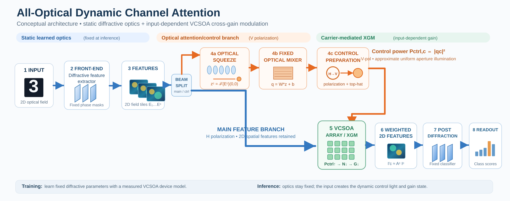
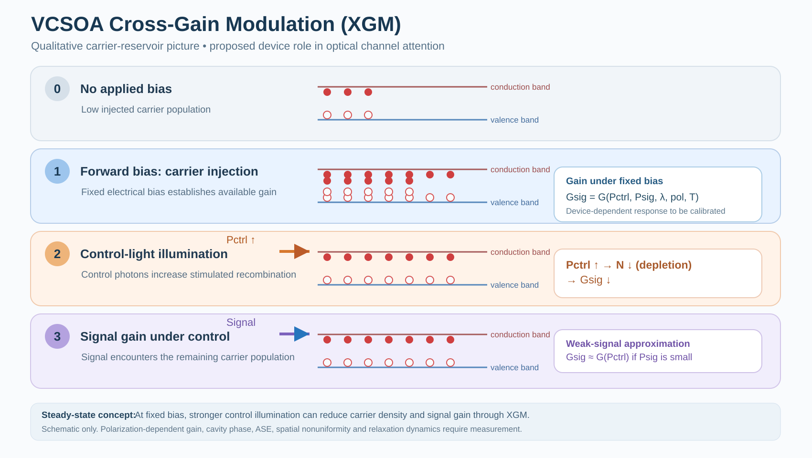

# Carrier-Mediated All-Optical Channel Attention for Diffractive Neural Computing

**English** | [简体中文](README.zh-CN.md)

*Dynamic two-dimensional channel recalibration through cross-gain modulation in broad-area VCSOAs.*

## Overview

We propose **input-adaptive, all-optical channel attention** for free-space diffractive neural computing. The idea is to keep the learned diffractive elements **static at inference** while deriving a channel-dependent optical control signal from each incoming optical feature. A **broad-area vertical-cavity semiconductor optical amplifier (VCSOA)** would then implement dynamic channel recalibration through **carrier-mediated cross-gain modulation (XGM)**.

The motivation is to explore whether the familiar *squeeze → channel mixing → recalibration* pattern can be realized with a two-dimensional optical feature path, without electronically computing and rewriting channel weights for every inference sample.

[](assets/architecture.svg)

*Figure 1. Proposed all-optical channel-attention system. **(a)** End-to-end optical architecture, including the Fourier squeeze, fixed diffractive mixer, V-polarized control preparation, VCSOA array, output polarization rejection, and diffractive readout. **(b)** One VCSOA channel, distinguishing complex field transfer from intensity weighting. **(c)** Offline device calibration and optical-parameter optimization, followed by frame-based quasi-CW inference with fixed learned optics. Blue denotes the H-polarized feature path, orange the control path, and green the VCSOA. Feature maps show normalized illustrative intensities; their spatial patterns are preserved under channel-scalar weighting. The complete system has not been experimentally demonstrated.*

[Open the full-resolution architecture SVG](assets/architecture.svg).

## Research question

**Can fixed learned diffractive optics produce sample-dependent control light that dynamically modulates full two-dimensional optical feature channels, through the gain state of a broad-area VCSOA, while preserving usable spatial information?**

In a digital squeeze-and-excitation block, an input feature tensor `U` is globally pooled into a channel descriptor `z`, converted into channel weights, and applied back to the original feature maps. In the optical proposal, the descriptor and control light remain in the optical domain, and the VCSOA provides a physically nonlinear, input-dependent gain element.

## Proposed optical computation

1. **Front-end diffraction.** Fixed learned phase masks produce spatially separated 2D optical feature channels `E_c(x,y)`.
2. **Split each channel.** The **main branch** retains the full 2D field. A lower-power **attention branch** generates a channel descriptor.
3. **Optical squeeze.** A lenslet/Fourier system samples the zero-spatial-frequency **field amplitude**, `z_c = F{E_c}(0,0)`. Its relationship to a sum of positive features requires approximate phase uniformity; this is **not generally equivalent to pooling intensity**.
4. **Static optical mixer.** A fixed trainable diffractive mapping produces `q = W(θ) z + b`, where `W` is unchanged across inputs but `q` varies with the input. The control power scales as `P_ctrl,c ∝ |q_c|²`.
5. **Control-beam preparation.** Rotate the control-light polarization and reshape each output into a near-uniform beam over a VCSOA aperture. H-polarized feature light and V-polarized control light are the **proposed** configuration; polarization-dependent XGM must be measured.
6. **VCSOA-mediated gain.** For fixed electrical bias, the control light can deplete the shared carrier population by stimulated emission, modulating the signal gain. In a weak-signal, near-uniform approximation, the **intensity** output is `I'_c(x,y) ≈ A_c I_c(x,y)` with `A_c = T_fix,c G_c(P_ctrl,c)`. In field notation, amplitude transmission is approximately proportional to `sqrt(G_c)`, with a potentially important phase factor.
7. **Post-attention diffraction and detection.** The weighted 2D fields enter fixed diffractive classification layers and are read out using photodetector regions.

### What makes attention dynamic?

The trained diffractive parameters are fixed, while

`E_c(input) → z(input) → q(input) → P_ctrl(input) → N(input) → G_c(input)`

depends on the current input. The goal is an **optically generated control state**, with no real-time per-sample PD → ADC → digital attention computation → DAC → modulator chain.

### Frame-based quasi-CW operation

The first proposed demonstration uses a steady-state, frame-based regime. Each input is held long enough for the optical control path and carrier dynamics to settle; outputs are read after settling. It does not assume picosecond synchronization or an experimentally validated high-speed device.

### Reading the training and inference workflow (Figure 1c)

**Offline training.** Measure the VCSOA response, fit a differentiable device model, and simulate the complete optical network on labeled training images. Compare the predicted class powers with the labels, compute a loss, and repeatedly optimize the front-end masks, realizable mixer parameters, and rear diffractive masks, with optional mixer bias and fixed attenuation. Deploy and freeze the resulting optical parameters.

**Optical inference.** Hold a new input frame while the fixed optics generate features and input-dependent control light. The control light sets the VCSOA carrier/gain state; read the final class powers after settling. The learned optical parameters remain fixed, while the control power and gain state vary across inputs. Photodetection provides the final classification readout; the attention weights are generated by the optical path and carrier dynamics.

The field and intensity relations in Figure 1b are:

```text
H_c = sqrt(G_c) exp(i phi_c)
E'_c = sqrt(T_fix,c) H_c E_c
A_c = T_fix,c G_c
I'_c(x,y) ≈ A_c I_c(x,y)
```

## How the VCSOA modulation is intended to work

[](assets/vcsoa-xgm.svg)

*Figure 2. Qualitative carrier-mediated cross-gain modulation. The four stages illustrate zero bias, forward bias, stimulated carrier depletion by control light, and the resulting reduction in signal gain. The lower panels show the simplified carrier-rate equation and the control-power/gain relationship under a weak-signal approximation. The drawings are conceptual, not measured energy-band diagrams or a claim of achieved device behavior.*

[Open the full-resolution VCSOA mechanism SVG](assets/vcsoa-xgm.svg).

A deliberately simplified carrier-rate model is:

```text
dN/dt = I_bias/(q V) - N/τ_N - R_stim,sig - R_stim,ctrl - R_nr
```

Under fixed bias and suitably weak signal illumination, increasing control power may lower the steady-state carrier density and the available signal gain:

`P_ctrl ↑ → R_stim,ctrl ↑ → N ↓ → G_signal ↓`.

Actual VCSOA gain is device- and operating-point-dependent, with wavelength, polarization, transverse nonuniformity, self-saturation, cavity phase, thermal drift, and amplified spontaneous emission all relevant. The usable response needs **measurement and calibration**; no universal numerical gain or power response is assumed.

## Scientific hypotheses and verification criteria

| Hypothesis | What must be verified |
| --- | --- |
| Optical squeeze captures useful channel descriptors | Quantify phase flatness and the relationship between Fourier zero order and feature descriptors |
| Input-dependent optical control | Measure distinct control powers for distinct inputs with all learned optical parameters held fixed |
| Approximate 2D channel-scalar gain | Measure spatial gain maps and feature fidelity across the VCSOA aperture |
| Carrier-mediated cross-gain modulation | Measure gain versus control and signal powers, polarization, wavelength, bias and temperature |
| End-to-end optical utility | Compare optical network with and without dynamic attention, against digital ideal and calibrated simulations |
| Robust, practical operation | Measure phase distortion, ASE/OSNR, drift, settling time, power, and inference throughput |

### Planned evaluation baselines

- Fixed diffractive classifier without attention.
- Idealized digital channel-attention reference.
- Device-aware simulated diffractive/VCSOA attention.
- Experimental optical implementation, **only once hardware is available**.

No accuracy, FLOPs, latency, energy, gain-dynamic-range, or speedup values are reported at this stage.

## Key risks and open challenges

- **Field versus intensity:** Fourier zero order integrates a complex field, whereas digital global-average pooling typically averages features; phase constraints or alternative physically native pooling are required.
- **Complex gain:** VCSOA-induced phase shift can affect subsequent diffraction even when intensity gain looks spatially uniform.
- **Polarization:** Orthogonally polarized control and signal beams suppress ideal direct interference, but do not guarantee efficient XGM in a birefringent cavity.
- **Spatial uniformity:** A broad-area amplifier may exhibit spatial gain variation; top-hat control illumination alone may not eliminate it.
- **Self-saturation and noise:** Signal power, ASE, thermal drift and device-to-device variability may restrict feasible operating points.
- **Efficiency claims:** Optical parallelism does not by itself establish system-level power, speed, or area improvements. All such claims require measured comparisons.

## Repository layout

```text
.
├── README.md               # English project overview
├── README.zh-CN.md         # 中文项目说明
├── assets/
│   ├── architecture.svg    # All-vector architecture, channel physics, and training/inference workflow
│   └── vcsoa-xgm.svg       # All-vector carrier and cross-gain-modulation schematic
└── LICENSE
```

Both SVG diagrams are vector artwork redrawn from the project's conceptual schematics; they are **illustrations, not experimentally calibrated optical layouts**.

## Current stage and roadmap

- [x] Outline architecture and scientific hypotheses
- [x] Document two optical branches and carrier-mediated gain concept
- [x] Publish bilingual conceptual overview and editable diagrams
- [ ] Validate device availability and optical/polarization operating point
- [ ] Characterize complex VCSOA response, phase, uniformity, saturation, noise, and response time
- [ ] Build calibrated differentiable simulator and compare baselines
- [ ] Prototype optical squeeze, mixer, and control-beam shaping
- [ ] Integrate main/control paths and demonstrate input-dependent gains
- [ ] Evaluate full 2D optical inference and physical efficiency

Checkboxes indicate **documentation milestones**, not experimental results.

## Background references

1. Hu, Shen & Sun. **Squeeze-and-Excitation Networks**, CVPR 2018. https://doi.org/10.1109/CVPR.2018.00745
2. Lin et al. **All-optical machine learning using diffractive deep neural networks**, *Science* 2018. https://doi.org/10.1126/science.aat8084
3. Marino & Balle. **Experimental study of a broad area vertical-cavity semiconductor optical amplifier**, *Optics Communications* 2004. https://doi.org/10.1016/j.optcom.2003.11.067
4. Marino, Furfaro & Balle. **Cross gain modulation in broad-area vertical cavity semiconductor amplifier**, *Applied Physics Letters* 2005. https://doi.org/10.1063/1.1905811
5. Zhang et al. **Optical image inversion and edge detection based on Vertical Cavity Semiconductor Optical Amplifiers**, *Information Photonics* 2005. https://doi.org/10.1364/IP.2005.IWA2

These references establish relevant prior physical mechanisms; they do **not** demonstrate this proposed integrated attention system.

## Research attribution

Concept and proposal: **Nan Li**, HKUST(Guangzhou). This repository records an early-stage research direction for collaborative optical neural computing. Public material is descriptive; equipment specifications, verified designs, datasets, code, and results will be added only after they exist. For collaboration, use [GitHub issues](../../issues).

## License

See [LICENSE](LICENSE). References and third-party components retain their own rights.
