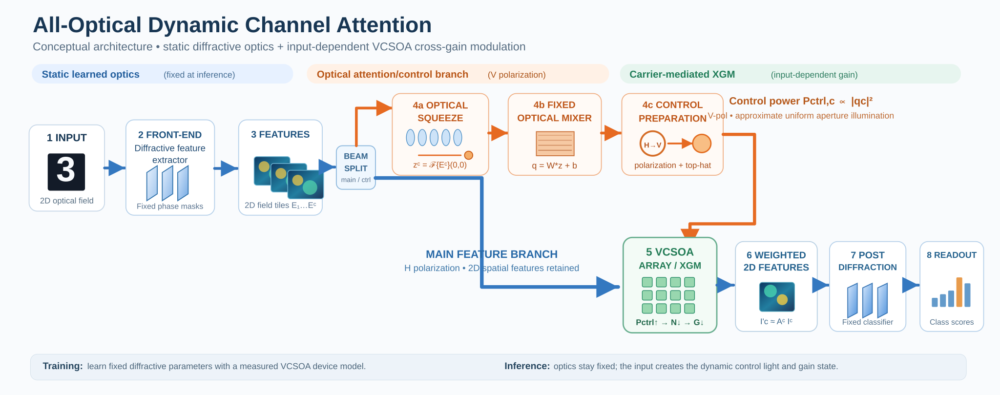
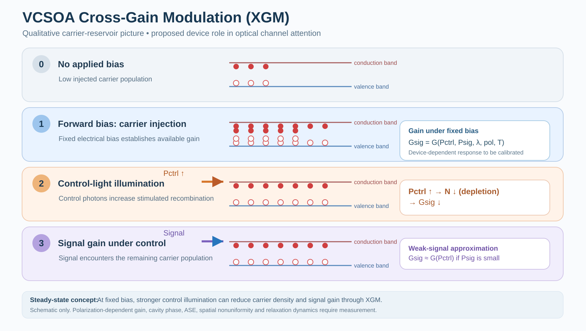

# 面向衍射神经计算的载流子介导全光通道注意力

[English](README.md) | **简体中文**

*利用大面积 VCSOA 的交叉增益调制，实现动态二维通道重标定。*

## 项目概述

本项目拟面向**自由空间衍射光学神经网络**构建一种**输入自适应的全光动态通道注意力机制**。核心思想是：**推理阶段的可学习衍射光学器件保持静态**，当前输入的二维特征光在一条光学注意力支路中产生控制光；再利用 broad-area vertical-cavity semiconductor optical amplifier（**VCSOA**）中的载流子介导交叉增益调制（**cross-gain modulation, XGM**），对主光路中的二维特征施加输入相关的通道增益。

研究动机是探索如何在物理光学域实现类似数字 Squeeze-and-Excitation（SE）的“特征压缩 → 通道混合 → 动态重标定”，并尽量保留二维空间并行光场，无需在每个推理样本上使用电子系统实时计算并回写通道权重。

[](assets/architecture.svg)

*图 1：拟议的全光通道注意力系统。**(a)** 端到端光学架构，包括 Fourier squeeze、固定衍射 mixer、V 偏振控制光整形、VCSOA 阵列、输出偏振滤除和衍射分类读出。**(b)** 单个 VCSOA 通道，区分光场复传输系数与光强权重。**(c)** 离线器件标定与光学参数优化，以及固定训练参数后的帧式准连续光稳态推理。蓝色表示 H 偏振主特征光路，橙色表示控制光路，绿色表示 VCSOA。特征热图展示归一化强度示意，通道标量施权前后保持相同空间图案。该图是概念方案，不代表已经完成的实验系统。*

[打开完整分辨率架构 SVG](assets/architecture.svg)。

## 核心科学问题

**能否在保持学习型衍射器件参数固定的条件下，由输入二维光学特征自身产生通道控制光，再通过 broad-area VCSOA 的增益状态对完整二维特征进行动态重标定，同时保持空间特征的可用性？**

传统数字 SE 通常对特征 `U` 做全局池化得到描述符 `z`，再产生各通道权重。这里拟在光学域生成描述符与控制光，并将 VCSOA 作为具有输入相关物理非线性响应的增益单元。

## 拟议的光学计算流程

1. **前端自由空间衍射：** 使用训练后固定的相位掩膜产生空间分离的二维光学特征通道 `E_c(x,y)`。
2. **通道分光：** 主支路保留完整二维光场；注意力支路抽取通道描述符。
3. **全光 Squeeze：** 用 lenslet / Fourier 系统获取零空间频率处的**复场幅度**，`z_c = F{E_c}(0,0)`。该量近似正比于非负特征的求和需要空间相位一致性条件；它**一般不等价于强度的全局平均池化**。
4. **固定光学 Mixer：** 使用衍射器件实现可学习但推理时固定的映射 `q = W(θ) z + b`。输入不同，`q` 随之变化；第 c 通道控制功率 `P_ctrl,c ∝ |q_c|²`。
5. **控制光束整形：** 通过偏振旋转与 top-hat 整形，使控制光近似均匀覆盖 VCSOA 有效孔径。采用主光 H 偏振、控制光 V 偏振是**拟议设计**，正交偏振下的有效 XGM 仍需具体器件标定。
6. **VCSOA 动态增益：** 在固定偏置下，控制光通过受激辐射消耗共享载流子，使信号可获得的增益发生变化。在弱信号、近似空间均匀的条件下，**光强**可表示为 `I'_c(x,y) ≈ A_c I_c(x,y)`，其中 `A_c = T_fix,c G_c(P_ctrl,c)`。对**光场幅度**的作用则与 `sqrt(G_c)` 及相位响应有关。
7. **后端衍射与读出：** 加权二维光场继续通过固定的衍射分类器，由光电探测区域获取类别结果。

### 动态注意力体现在哪里？

训练完成后，衍射参数固定；但对不同输入：

`E_c(input) → z(input) → q(input) → P_ctrl(input) → N(input) → G_c(input)`

均会发生变化。拟实现的动态通道权重来源于**输入光驱动的物理状态**，目标是避免实时的 PD → ADC → 数字注意力计算 → DAC → 调制器权重写入链路。

### Frame-based quasi-CW 操作

第一阶段拟采用帧式准连续光的稳态读出：在一个输入帧保持不变的时间窗口内，等待注意力支路和载流子状态达到稳定后读出。此阶段不假设已经解决皮秒级光程同步，也不声称已实现超高速硬件运行。

### 如何理解训练与推理流程（图 1c）

**离线训练：** 先测量 VCSOA 响应，建立可微器件模型，再在计算机中模拟完整光学网络。对带标签的训练图片计算类别输出和损失，反复优化前端掩模、可实现的 mixer 参数及后端掩模，并可优化静态偏置与固定衰减。最后将训练参数部署到光学器件并固定。

**光学推理：** 保持一帧新输入，让固定光路产生二维特征及输入相关控制光。控制光设置 VCSOA 的载流子 / 增益状态，待系统稳定后读取类别功率。训练得到的光学参数保持固定，但控制光功率和通道增益随输入变化。末端光电探测负责分类读出，注意力权重由光路和载流子动力学生成。

图 1b 中，光场传输和光强权重分别为：

```text
H_c = sqrt(G_c) exp(i phi_c)
E'_c = sqrt(T_fix,c) H_c E_c
A_c = T_fix,c G_c
I'_c(x,y) ≈ A_c I_c(x,y)
```

## VCSOA 中的交叉增益调制（XGM）

[](assets/vcsoa-xgm.svg)

*图 2：载流子介导交叉增益调制的定性示意。四个阶段依次展示无偏置、正向偏置、控制光通过受激辐射耗尽载流子，以及信号光获得的增益降低。下方给出简化载流子速率方程和弱信号近似下的控制功率—增益关系。图中的能带和载流子分布为概念示意，未使用实测能带数据。*

[打开完整分辨率 VCSOA 机制 SVG](assets/vcsoa-xgm.svg)。

简化载流子速率方程：

```text
dN/dt = I_bias/(q V) - N/τ_N - R_stim,sig - R_stim,ctrl - R_nr
```

在固定偏置、信号足够弱且器件工作点适宜时：

`P_ctrl ↑ → R_stim,ctrl ↑ → N ↓ → G_signal ↓`。

实际的 VCSOA 响应取决于器件结构、偏置、工作波长、偏振、控制与信号功率、温度等参数。**腔体相位、空间增益非均匀性、信号自饱和与自发辐射噪声**都必须实测或标定。当前不假定任何特定器件的数值增益和响应速度。

## 科学假设与实验判据

| 待验证的假设 | 主要验证方式 |
| --- | --- |
| 光学 squeeze 能形成有效通道描述符 | 测量特征相位平坦度，并比较 Fourier 零阶场与目标描述符 |
| 控制光可随输入动态变化 | 固定所有光学参数，测量不同输入下的控制光功率 |
| VCSOA 对二维特征施加近似通道标量增益 | 测量空间增益图、通道内非均匀性和特征保真度 |
| XGM 可在目标工作区有效工作 | 测量控制 / 信号功率、偏振、波长、偏置与温度对增益的影响 |
| 动态注意力提高光学网络表现 | 对比无注意力衍射网络、数字理想参考、器件感知仿真和真实光学系统 |
| 整体系统具有可行性 | 测量相位误差、ASE/OSNR、漂移、稳态建立时间、功耗与吞吐量 |

### 计划比较的基线

- 不含动态注意力的固定衍射分类器。
- 理想数字通道注意力模型。
- 采用实测器件响应的 Device-aware 光学仿真。
- **获得硬件后**的真实全光动态注意力系统。

当前没有能够报告的分类准确率、系统时延、能耗、加速比或实测动态增益范围。

## 主要技术风险

- **场幅与光强的区别：** Fourier 零阶提取复场积分，必须验证相位条件，才能与数字 SE 的池化含义建立联系。
- **复数增益：** VCSOA 同时改变光强和相位，后端衍射对相位变化敏感。
- **偏振相关性：** 正交偏振可理想化地抑制直接干涉，但腔体双折射可能影响 XGM 效率。
- **横向非均匀性：** broad-area 器件的增益可能随空间位置变化，均匀控制光也不必然产生严格均匀增益。
- **自饱和与噪声：** 主信号光耗尽载流子、ASE、热漂移和器件差异会限制工作点。
- **系统效率：** 光学并行性本身不足以证明系统级能耗或时延更优，必须与真实测量和对照系统比较。

## 仓库结构

```text
.
├── README.md               # English
├── README.zh-CN.md         # 中文
├── assets/
│   ├── architecture.svg    # 完整架构、通道物理及训练/推理矢量图
│   └── vcsoa-xgm.svg       # XGM 能带与载流子机制矢量图
└── LICENSE
```

两张 SVG 都根据概念方案重新绘制，可用矢量编辑器修改，**不代表经过器件标定的光学工程图纸**。

## 当前进度与后续计划

- [x] 完成整体架构与核心假设设计
- [x] 整理主光路、注意力支路和 XGM 原理
- [x] 编写中英文 README、提供可编辑 SVG 图
- [ ] 核实 broad-area VCSOA 器件可获得性与偏振工作点
- [ ] 标定复数传输函数、增益空间均匀性、噪声、自饱和及恢复时间
- [ ] 构建 Device-aware 可微仿真及基线比较
- [ ] 验证光学 squeeze、mixer、top-hat 控制光束
- [ ] 联调主 / 控制光路并实测输入相关通道增益
- [ ] 完成二维光学分类与系统效率评估

已勾选条目仅代表**方案和文档工作已完成**。

## 相关参考文献

1. Hu, Shen & Sun. **Squeeze-and-Excitation Networks**, CVPR 2018. https://doi.org/10.1109/CVPR.2018.00745
2. Lin et al. **All-optical machine learning using diffractive deep neural networks**, *Science* 2018. https://doi.org/10.1126/science.aat8084
3. Marino & Balle. **Experimental study of a broad area vertical-cavity semiconductor optical amplifier**, *Optics Communications* 2004. https://doi.org/10.1016/j.optcom.2003.11.067
4. Marino, Furfaro & Balle. **Cross gain modulation in broad-area vertical cavity semiconductor amplifier**, *Applied Physics Letters* 2005. https://doi.org/10.1063/1.1905811
5. Zhang et al. **Optical image inversion and edge detection based on Vertical Cavity Semiconductor Optical Amplifiers**, *Information Photonics* 2005. https://doi.org/10.1364/IP.2005.IWA2

上述文献为物理机制与相关器件提供先前研究基础，并未证明本项目提出的整体集成注意力架构已经实现。

## 研究说明

方案提出与概念设计：**Nan Li，香港科技大学（广州）**。本仓库记录一个处于早期阶段的光学神经计算合作研究方向。后续仅在获得实际代码、实验和结果后更新相应材料。合作交流可通过 [GitHub Issues](../../issues) 联系。

## License

见 [LICENSE](LICENSE)。引用文献和第三方资源保留其原有权利。
